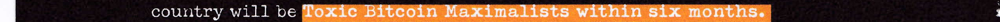
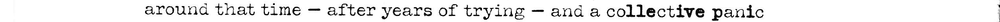

# G04: measurement coverage remains inconclusive

Source audit completed **2026-11-10T14:23:07.166Z**. Root subsequently inspected both byte-pinned native exhibits below. This is a separate source-measurement audit and decoder-scope clarification. Frozen G04 results, protocol, source geometry and code remain unchanged.

The recorded run measured **104 of 142 rows / 811 gaps**. **38 rows failed optical guards**, leaving **zero complete pages and zero retained/evaluated page/global decodes**. This is an unresolved measurement gap, not a negative key or cipher result.

One AI assistant inspected ten representative native row crops. A separate AI assistant checked static code, saved guard metadata, geometry fields and the hashes of 38 existing source crops; that second pass did not inspect pixels or recompute masks/gaps. The observations do not causally explain every failed row and do not establish that all 38 can be recovered.

## Saved first-failure coverage

| Recorded first guard | Rows |
|---|---:|
|Horizontal word-region boundary contact|23|
|Vertical region boundary contact|13|
|No robust ink columns|1|
|No robust ink rows|1|

The detector stops at the first failing word. It stores rowID/reason but not the failed word/index, boundary side, crop bounds, polarity or occupancy trace. These labels are not an exhaustive count of all failures within a row.

| Row ID | Saved first failure |
|---|---|
| `p75r03` | `ink-touches-vertical-region-boundary` |
| `p75r08` | `ink-touches-word-region-boundary` |
| `p75r09` | `ink-touches-word-region-boundary` |
| `p75r10` | `ink-touches-word-region-boundary` |
| `p75r11` | `ink-touches-word-region-boundary` |
| `p75r12` | `ink-touches-word-region-boundary` |
| `p75r24` | `ink-touches-word-region-boundary` |
| `p76r07` | `ink-touches-vertical-region-boundary` |
| `p76r08` | `ink-touches-word-region-boundary` |
| `p76r16` | `ink-touches-word-region-boundary` |
| `p76r24` | `ink-touches-word-region-boundary` |
| `p76r26` | `ink-touches-word-region-boundary` |
| `p76r31` | `ink-touches-vertical-region-boundary` |
| `p77r05` | `no-robust-ink-columns` |
| `p77r06` | `ink-touches-word-region-boundary` |
| `p77r07` | `ink-touches-word-region-boundary` |
| `p77r11` | `ink-touches-vertical-region-boundary` |
| `p77r12` | `no-robust-ink-rows` |
| `p77r15` | `ink-touches-vertical-region-boundary` |
| `p77r16` | `ink-touches-vertical-region-boundary` |
| `p77r18` | `ink-touches-word-region-boundary` |
| `p77r20` | `ink-touches-word-region-boundary` |
| `p77r30` | `ink-touches-word-region-boundary` |
| `p77r32` | `ink-touches-vertical-region-boundary` |
| `p78r02` | `ink-touches-vertical-region-boundary` |
| `p78r06` | `ink-touches-word-region-boundary` |
| `p78r08` | `ink-touches-vertical-region-boundary` |
| `p78r09` | `ink-touches-word-region-boundary` |
| `p78r10` | `ink-touches-word-region-boundary` |
| `p79r01` | `ink-touches-word-region-boundary` |
| `p79r02` | `ink-touches-vertical-region-boundary` |
| `p79r03` | `ink-touches-word-region-boundary` |
| `p79r05` | `ink-touches-word-region-boundary` |
| `p79r06` | `ink-touches-vertical-region-boundary` |
| `p79r07` | `ink-touches-vertical-region-boundary` |
| `p79r16` | `ink-touches-word-region-boundary` |
| `p79r22` | `ink-touches-vertical-region-boundary` |
| `p79r24` | `ink-touches-word-region-boundary` |

## Source-supported risks

White type on orange, black-on-white inverse blocks, white-on-black text and within-row contrast changes make a per-page polarity choice insufficient. The frozen edge-background maxRGB rule can plausibly select the wrong foreground on colored backgrounds. The pixel review reported a visible strike-through in p76r08; graphic/annotation/occluded ink must not silently become glyph support.

The frozen source has 15 standalone punctuation tokens in 13 rows. All 15 boxes, centers and polygons are null. Twelve of those 13 rows fail the horizontal guard; p78r07 is the sole nonfailed punctuation row. Standalone dashes can enter or be bisected by lexical-word midpoint regions. This is a source risk and correlation, not proof of the first failed word in all 12 rows.

Approximate lexical OCR boxes do not certify full glyph containment. The vertical envelope adds 2 px and is clipped to neighbor-center midpoints; horizontal regions use lexical-box midpoints and 12 px outer extensions. Merely loosening guards or changing margins until a readable output appears is not a justified repair.

## Separate correction to decoder-scope wording

Zero retained/evaluated decodes is correct. The frozen code calls `binary_decodes` **before** incomplete-scope filtering, constructing temporary measured-subset decoded strings that are then discarded. Therefore wording that no page/global string was decoded overstates the internals. This clarification is separate from the frozen report; it does not rewrite historical artifacts or claim a new decoding run.

## One proposed corrective procedure

First register a **bit-free first-failure trace**: word identity, bounds, side and polarity/foreground evidence only, without gaps, bits or decodes. Then independently source-proof and freeze one outcome-blind polarity/glyph-support fixture for **all 142 rows / 1258 tokens: 1243 lexical words plus 15 standalone punctuation tokens**, including the 104 previously measured rows. Keep punctuation, graphics and uncertain/occluded support distinct.

Retain row/word order and consecutive lexical-word pairs, the strict **>1.5× row median / equality 0** rule, page/global scopes and declared decoders. Do not skip dash-adjacent pairs, fill missing bits or concatenate only successful rows. Unknown support keeps its affected scope inconclusive. A repaired runner should reject incomplete coverage before decoding.

This preserves the encoding hypothesis while changing measurement support/polarity, requiring a **separate corrective preregistration and new pins**. It does not promise recovery of all 38 or independently validate the old 104 measurements. Controls must cover mixed/inverse polarity, punctuation, large boundary-touching glyphs and strike-through/graphic contamination.

Two byte-pinned native PNG crops are included as exhibits: p77r05 (white-on-orange) and p75r08 (standalone dashes). Each is 2544×58 RGB; PNG CRCs pass, with only IHDR/IDAT/IEND chunks and no embedded text/EXIF/profile or trailing bytes. Root visually reviewed both strips. Public copies match the recorded hashes byte for byte; no source pixels were changed.

Exact row metadata and public-relative artifact pins are in [SOURCE.json](SOURCE.json). No new ink measurement, gap/bit/decoder generation, format test, network request occurred in the source-measurement audit.

## Native source exhibits

White glyphs on black and orange occur in the same row (p77r05):

Long dashes lie between lexical words; the frozen punctuation fixture has no located glyph support for these tokens (p75r08):

These two examples illustrate source risks. They do not causally explain all 38 failures or authenticate a spacing cipher. Article/source rights remain with the original owners; this packet grants no reuse rights.
