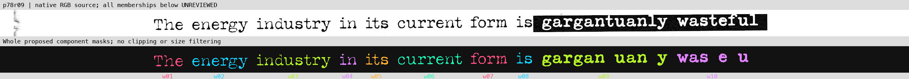
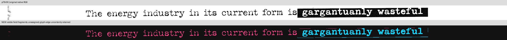

# Source masks: two pilot rows accepted; full spacing support remains open

Three AI assistants divided a first visual review of **all 142 body rows / 1,258 canonical tokens**. The [native source inventory](../../../sources/g04-native-rows/SOURCE.json) and [qualitative contrast labels](../../../sources/g04-native-rows/VISUAL_CLASSES.json) preserve every row and token. All 142 PNGs are byte-identical native crops, with valid CRCs and only IHDR/IDAT/IEND chunks. This is source preparation, not a new cipher test or a solved key.

## What was actually completed

The unchanged dark/light predicates produced **12,481 eight-connected components**, retaining single pixels, border-connected regions and background fields. An independent dense-pixel/set implementation verified both layers on all 142 rows: **21,926,736 native pixels / 284 layer checks**, exact membership, connectivity, ordering, areas, bounds and source pins. The [atlas](COMPONENT_ATLAS.json), [pixel review](ATLAS_REVIEW.json), [kernel review](COMPONENT_KERNEL_REVIEW.json) and [code port check](CODE_PORT_CHECK.json) are public.

The [locator audit](LOCATOR_AUDIT.json) confirms that all 1,243 old lexical boxes came from retained Vision substring-range responses. No local equal-width interpolation or replacement-box averaging was found. They remain approximate recognition locators, not certified glyph outlines. Vision's internal localization is not established by the API response.

Two fixed source-risk rows now have **independently accepted token-to-component membership**: p75r08 and p77r05, **22 tokens / 125 glyph components**, plus 32 explicitly nonglyph components. All 157 components in those pilot rows are accounted for once. Six tiny detached fragments received separate source/mask inspection. The second dash's old coarse visual envelope was inaccurate; it was never containment-certified and is not used as support. The unchanged retained pixel set is authoritative for this pilot. [Accepted membership](ACCEPTED_PILOT.json), [original proposal](PILOT_PROPOSAL.json), [independent proof](PILOT_PEER_REVIEW.json).

This acceptance covers fixed-threshold source-component ownership. It does not certify original font/ink completeness, validate a cipher, repair all 142 rows or authorize a new gap decode. **1,236 token memberships remain unaccepted.**

## Why the inverse fields need a different model

The exact atlas exposed a limitation in the automatic ownership proposal: some letters connect to surrounding paper or page background at inverse-field edges. Omitting border-connected components drops parts of lettering. Whole-component grouping cannot silently cut those connections.

The three-row feasibility pilot therefore declared a **separate visible-field model** before generating fragments: four source-annotated inverse polygons and three base complements, covering 34 tokens. Pixel centers use the explicit closed even-odd polygon rule. Existing thresholds stay fixed; no morphology, size filtering, font completion or word-boundary cuts are applied. The result contains **261 newly labelled fragments / 84 aperture-boundary contacts**. Independent reconstruction verified the actual polygons, selected pixels, partitions, parent links, maximal fragments and contact flags. [Frozen apertures](aperture/APERTURES.json), [execution plan](aperture/EXECUTION_PLAN.json), [fragment data](aperture/FRAGMENTS.json), [computational proof](aperture/COMPUTATIONAL_REVIEW.json).

Readable interior lettering reappears, but **13 source-recognized glyph/field joins still hide original contours**, and paper/panel-edge residue remains. Two AI contexts inspected the resulting views; the aperture author's detailed [visual review](aperture/VISUAL_REVIEW.json) and root's source comparison agree that this does **not** establish full original horizontal glyph support. The polygon's ±2 px note is manual source-model uncertainty, not a calibrated error bound or an alternate-polygon sweep.

**Stop full-source containment certification at this pilot.** Do not turn readable clipped masks into complete original-glyph evidence, assign edge fringe to words, tune the polygons after viewing a decode, or silently expand this model across all rows. Restricted visible-field ownership is a distinct possible model; it has not completed a 142-row source proof or a key test. No corrective G04 decode ran, and the original spacing result stays inconclusive.

The exact whole-component proposal loses some lettering:



The separately declared field model recovers readable interiors while retaining panel-edge residue:



These are explanatory source views, not decoded messages or authenticated geometry.

## Next source question

An original typesetting/layout witness could resolve support that this raster cannot separate. The [bounded publisher search](NATIVE_SOURCE_SEARCH.json) recovered no native/vector issue file. The print excerpt is readable through a normal browser despite an earlier HTTP403 fetch; its observed full-issue link points to a print subscription. The inspected store page offers the physical issue and showed no public PDF/reader option. This is not proof that no original digital file exists.

A [bounded local loose-PDF inventory](LOCAL_NATIVE_PDF_CHECK.json) also found no omitted native-layout witness: six occurrences reduce to two raster/OCR documents. Every page uses a single raster with invisible OCR, not visible typesetter text. All eight target-page image payloads and decoded pixels match the public target; stripping private wrapper metadata did not remove a higher-quality layout source. Public image payloads have no EXIF/GPS tags. This does not exclude files in archives or elsewhere.

The [official Typeka Mix specimen](https://www.t26.com/fonts/183-Typeka) also supplies an ordinary explanation for within-word weight changes. It does not identify the article's actual font or exclude typography encodings; it does prevent treating those changes alone as a new creator-authenticated binary instruction. The [priority note](FONT_NULL.json) records that limited inference. No new typography decoder was run.

## Reproduce the source stages

Python 3.9+ with the existing Pillow, NumPy and PyMuPDF environment. From the public research root, create a fresh private parent directory with mode 0700 outside the entire Git checkout. The native input crops are included, so OCR and a machine-specific font are not required for these computations.

```sh
python3 scripts/build_component_atlas.py --self-test
python3 scripts/build_component_atlas.py --run --manifest sources/g04-native-rows/SOURCE.json --expected-manifest-sha a63192daa4b713d90f3e87cc379866d74df494ccf9aa1bc1251504cd32820a7d --out FRESH_PRIVATE_PARENT/ATLAS.json
python3 scripts/field_fragment_kernel.py
python3 scripts/build_field_fragments.py --inventory sources/g04-native-rows/SOURCE.json --atlas analysis_outputs/continuation_20261110/g04_source_support/COMPONENT_ATLAS.json --apertures analysis_outputs/continuation_20261110/g04_source_support/aperture/APERTURES.json --out FRESH_PRIVATE_PARENT/FIELD_RUN
```

The original proposal/review receipts preserve historical working filenames; public counterparts are COMPONENT_ATLAS.json, PILOT_PROPOSAL.json and aperture/FRAGMENTS.json. Their file bytes and SHA-256 pins are unchanged by renaming. Runtime timestamps make a replay artifact differ as a whole; compare source pixels, component/fragment records and declared counts. Personal filesystem paths are excluded.

No interword gaps, gap medians, bits, decoders, candidate checks or wallet operations were performed in these source stages. The public [summary](RESULT.json) records actual work and remaining limits. The puzzle remains unsolved. Article and source rights remain with their original owners.
