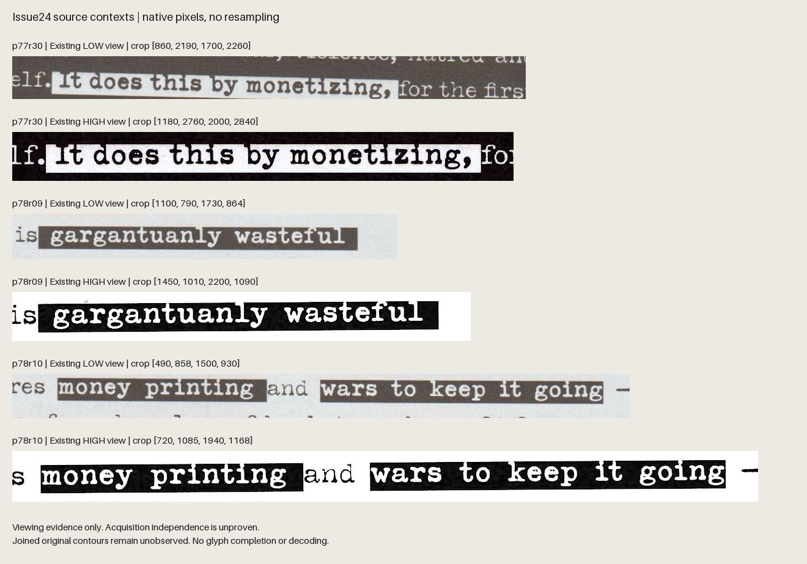

# A second retained view still leaves the contours open

**The same three inverse-field contexts remain unresolved in both retained scans.** This comparison adds source evidence, not a cipher result: the 13 previously declared glyph/field contacts still have no certified complete original contours. The original G04 spacing test remains inconclusive.

## What was compared

The existing [higher-resolution scan](/research/magazine.pdf) contains eight 2544 x 3264 pages; the existing [lower-resolution scan](/research/keyser%20bitcoin%20.pdf) contains eight 2040 x 2805 pages. Printed pages 77/78 were extracted from each PDF. The high witness's declared 180-degree rotation was applied by exact pixel indexing; neither source was interpolated or repaired.

Six manually nominated native crops cover p77r30, p78r09 and p78r10. The combined exhibit pastes their source pixels at 1:1 scale; labels sit outside the source images. [Crop boxes and hashes](CROP_MANIFEST.json) identify the exact upright coordinate frame, image fingerprints and unchanged crop bytes. [Source metadata](SOURCE.json) pins both public PDFs and all four decoded RGB pages.

At these fixed contexts, the lower-resolution view also shows glyph-to-ambient joins around the inverse fields, including the previously declared left-side contact. It supplies no complete original-contour certification for the 13 prior contact tokens. This is a qualitative AI source inspection; readable lettering is not proof of the missing outline.

**Acquisition independence is unproven.** Different bytes, dimensions, framing and geometry do not exclude digital transformations or common ancestry. Neither retained PDF is a newly recovered independent witness. The [independent source verification receipt](ROOT_SOURCE_VERIFICATION.json) confirms two PDF hashes, four upright RGB images, six exact crops and visual agreement; it does not prove independent acquisition or original glyph completeness.

## What the bounded search established

Twelve focused queries over the exact article title and publisher/public-reader/archive routes recovered no usable new native-layout artifact, pre-layout manuscript or independently authenticated scan. The exact publisher-only title query returned no results. This is bounded non-discovery, not proof that no original file exists.

Two direct, prebatched ordinary store reads returned HTTP 429 with Retry-After: 60. Neither was retried; the route stopped after those responses were reviewed. Earlier web-tool readable text is distinct from a fresh successful file retrieval. No availability, stock or purchase claim follows. Raw responses, account information and full extracted pages are excluded from this export.

## What would change the evidence

A legitimately obtained publisher prepress/layout export could help if it retains actual glyph/font objects separately from the inverse fields. Invisible OCR or a new raster wrapper is insufficient. First verify page identity and compare the same 13 contact cases before proposing any source-mask or spacing repair.

A provenance-established separate clean-print scan might resolve blur or scanning damage. Higher resolution alone cannot reveal an intended contour where lettering and the neighboring field have the same printed color; actual improvement must be shown at the fixed contacts.

No new glyph mask, aperture, interword measurement, gap median, bit, decoder, cryptographic check or wallet operation ran. No original font contour was guessed. See the [owning source-support result](/research/analysis_outputs/continuation_20261110/g04_source_support/RESULT.md) for the accepted 22-token pilot and the unresolved wider scope. This comparison does not expand that acceptance to all 142 rows. The puzzle remains unsolved.

## Creator context and the linked illustrations

The later [El Salvador remark](https://x.com/maxkeiser/status/1741134493769965603) exposes an exact [quoted-parent URL](https://x.com/realsharktoshi/status/1741133781321523668). Its parent text is unavailable in the current conversation. Two focused index queries returned no results; one exact canonical Internet Archive CDX request returned HTTP200 with no rows. This does not clear other aliases, captures or account history. The magazine-puzzle connection remains unverified. The retained BitcoinNews report URL also showed a normal-browser404. [Context receipt](CREATOR_CONTEXT.json).

All three official figures in [Schott’s mirror-writing paper](https://pmc.ncbi.nlm.nih.gov/articles/PMC2117809/) were inspected directly. They show a reversed handwritten letter, changing character orientations in vertical script, and notebook text/arithmetic with varied numeral orientations. They establish no particular magazine page pair, mask or key format. No full handwriting transcription or translation was attempted. The figure images are not redistributed here; exact official asset URLs and hashes are in the [figure review](PAPER_FIGURES.json). These observations supply no new creator-directed extraction rule.
